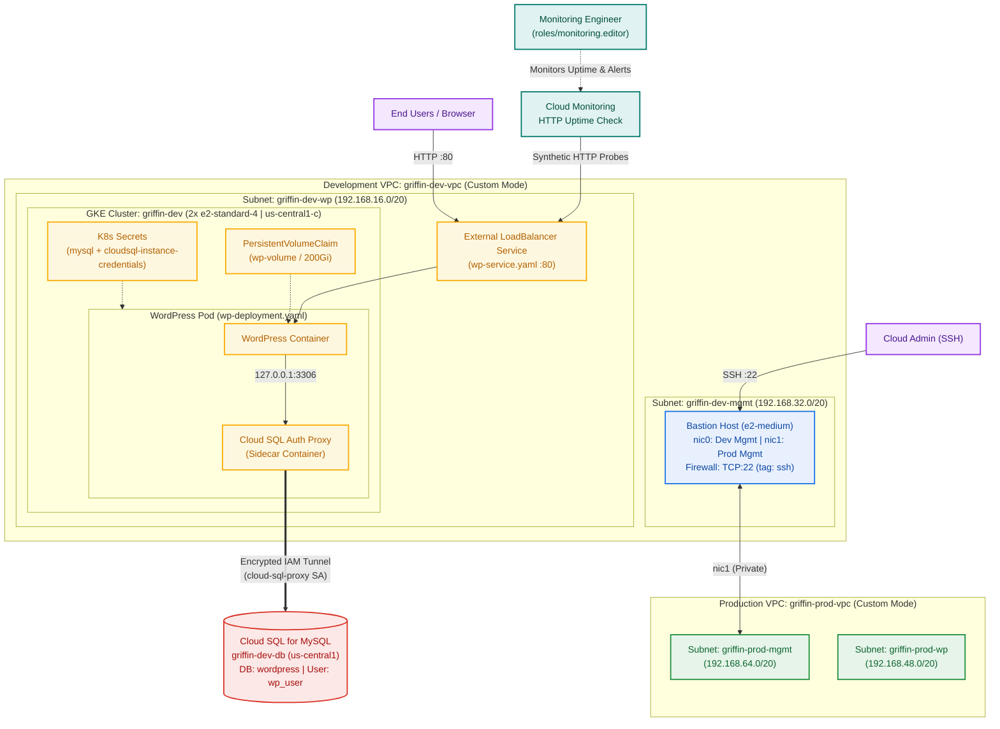

# Multi-VPC Enterprise Network & Containerized WordPress on Google Cloud (GKE + Cloud SQL)

A hands-on Google Cloud Platform (GCP) architecture project demonstrating **custom multi-VPC network segmentation**, a **dual-homed (multi-NIC) Bastion Host**, **Google Kubernetes Engine (GKE)** stateful workloads, **Cloud SQL Auth Proxy sidecar** database connectivity, **Cloud Monitoring** synthetic uptime checks, and **least-privilege IAM**.

> Built as part of the **Associate Cloud Engineer** learning path (*Develop Your Google Cloud Network*).

---

## Architecture Diagram



---

## Network & CIDR Plan

| Environment | VPC Name | Mode | Subnet Name | Region | CIDR Block | Purpose |
| :--- | :--- | :--- | :--- | :--- | :--- | :--- |
| **Development** | `griffin-dev-vpc` | Custom | `griffin-dev-wp` | `us-central1` | `192.168.16.0/20` | GKE cluster & WordPress workloads |
| **Development** | `griffin-dev-vpc` | Custom | `griffin-dev-mgmt` | `us-central1` | `192.168.32.0/20` | Bastion host primary interface (`nic0`) |
| **Production** | `griffin-prod-vpc` | Custom | `griffin-prod-wp` | `us-central1` | `192.168.48.0/20` | Isolated production application subnet |
| **Production** | `griffin-prod-vpc` | Custom | `griffin-prod-mgmt` | `us-central1` | `192.168.64.0/20` | Bastion host secondary interface (`nic1`) |

*(All CIDR blocks are strictly non-overlapping to support multi-NIC appliances and future VPC peering.)*

---

## Key Cloud & Security Engineering Concepts Demonstrated

- **Custom VPC Segmentation:** Separates Development and Production environments and isolates workload traffic (`-wp`) from administrative traffic (`-mgmt`).
- **Dual-Homed Multi-NIC Bastion Host:** Bridges `griffin-dev-mgmt` and `griffin-prod-mgmt` on a single cost-effective `e2-medium` VM protected by tag-scoped ingress firewall rules (`tcp:22`).
- **Sidecar Database Security Pattern:** WordPress connects locally (`127.0.0.1:3306`) to a **Cloud SQL Auth Proxy** sidecar container inside the Pod, which opens an encrypted, IAM-authenticated tunnel to Cloud SQL (`griffin-dev-db`).
- **Stateful Kubernetes on GKE:** Uses a `PersistentVolumeClaim` so WordPress media/uploads persist across Pod restarts and isolates credentials in Kubernetes `Secrets`.
- **Observability & Least-Privilege IAM:** Implements Cloud Monitoring synthetic HTTP uptime checks and grants scoped operational access (`roles/monitoring.editor`) rather than broad project-wide basic roles.

---

## Prerequisites

- A Google Cloud Project with billing enabled
- [Google Cloud CLI (`gcloud`)](https://cloud.google.com/sdk/docs/install) and `kubectl` (or **Google Cloud Shell**)
- Required GCP APIs enabled:
  ```bash
  gcloud services enable \
    compute.googleapis.com \
    container.googleapis.com \
    sqladmin.googleapis.com \
    iam.googleapis.com \
    monitoring.googleapis.com
  ```

---

## Step-by-Step Deployment Guide

### Step 0: Set Environment Variables
Set your project, region, zone, and credentials once so every command below runs cleanly:

```bash
export PROJECT_ID=$(gcloud config get-value project)
export REGION="us-central1"
export ZONE="us-central1-c"
export DB_ROOT_PASSWORD="ChangeMeRoot!123"
export WP_DB_PASSWORD="ChangeMeWpUser!123"
export ADDITIONAL_ENGINEER_EMAIL="engineer@example.com"
```

---

### Step 1: Create the Custom Development VPC (`griffin-dev-vpc`)

```bash
gcloud compute networks create griffin-dev-vpc \
  --subnet-mode=custom

gcloud compute networks subnets create griffin-dev-wp \
  --network=griffin-dev-vpc \
  --region=$REGION \
  --range=192.168.16.0/20

gcloud compute networks subnets create griffin-dev-mgmt \
  --network=griffin-dev-vpc \
  --region=$REGION \
  --range=192.168.32.0/20
```

---

### Step 2: Create the Custom Production VPC (`griffin-prod-vpc`)

```bash
gcloud compute networks create griffin-prod-vpc \
  --subnet-mode=custom

gcloud compute networks subnets create griffin-prod-wp \
  --network=griffin-prod-vpc \
  --region=$REGION \
  --range=192.168.48.0/20

gcloud compute networks subnets create griffin-prod-mgmt \
  --network=griffin-prod-vpc \
  --region=$REGION \
  --range=192.168.64.0/20
```

---

### Step 3: Deploy the Multi-NIC Bastion Host & SSH Firewall Rules

```bash
# Create dual-NIC bastion host bridging Dev and Prod management subnets
gcloud compute instances create griffin-dev-bastion \
  --zone=$ZONE \
  --machine-type=e2-medium \
  --tags=ssh \
  --network-interface=subnet=griffin-dev-mgmt \
  --network-interface=subnet=griffin-prod-mgmt,no-address

# Allow SSH (TCP:22) to tagged bastion instances
gcloud compute firewall-rules create allow-dev-bastion-ssh \
  --network=griffin-dev-vpc \
  --allow=tcp:22 \
  --source-ranges=0.0.0.0/0 \
  --target-tags=ssh

gcloud compute firewall-rules create allow-prod-bastion-ssh \
  --network=griffin-prod-vpc \
  --allow=tcp:22 \
  --source-ranges=0.0.0.0/0 \
  --target-tags=ssh
```

*(Verify connectivity with `gcloud compute ssh griffin-dev-bastion --zone=$ZONE`.)*

---

### Step 4: Provision & Initialize the Cloud SQL (MySQL) Instance

```bash
gcloud sql instances create griffin-dev-db \
  --database-version=MYSQL_8_0 \
  --region=$REGION \
  --zone=$ZONE \
  --tier=db-n1-standard-1 \
  --edition=ENTERPRISE \
  --root-password="$DB_ROOT_PASSWORD"
```

Connect to `griffin-dev-db` and initialize the `wordpress` database and user:

```bash
gcloud sql connect griffin-dev-db --user=root --quiet
```

Inside the `mysql>` prompt, run (replacing `<WP_DB_PASSWORD>` with your password):

```sql
CREATE DATABASE wordpress;
CREATE USER 'wp_user'@'%' IDENTIFIED BY '<WP_DB_PASSWORD>';
GRANT ALL PRIVILEGES ON wordpress.* TO 'wp_user'@'%';
FLUSH PRIVILEGES;
EXIT;
```

---

### Step 5: Create the GKE Cluster (`griffin-dev`)

```bash
gcloud container clusters create griffin-dev \
  --zone=$ZONE \
  --machine-type=e2-standard-4 \
  --num-nodes=2 \
  --network=griffin-dev-vpc \
  --subnetwork=griffin-dev-wp

# Fetch cluster credentials for kubectl
gcloud container clusters get-credentials griffin-dev --zone=$ZONE
```

---

### Step 6: Prepare Kubernetes Secrets, Storage & Cloud SQL Proxy IAM

1. **Create the `cloud-sql-proxy` Service Account** (if not already present) and grant `roles/cloudsql.client`:
   ```bash
   gcloud iam service-accounts create cloud-sql-proxy \
     --display-name="Cloud SQL Proxy Service Account"

   gcloud projects add-iam-policy-binding $PROJECT_ID \
     --member="serviceAccount:cloud-sql-proxy@${PROJECT_ID}.iam.gserviceaccount.com" \
     --role="roles/cloudsql.client" \
     --condition=None
   ```

2. **Create the local `wp-env.yaml` from the template** (ignored by `.gitignore`) and apply it:
   ```bash
   cp k8s/wp-env.yaml.example k8s/wp-env.yaml
   sed -i "s/<REPLACE_WITH_DB_PASSWORD>/${WP_DB_PASSWORD}/g" k8s/wp-env.yaml
   kubectl apply -f k8s/wp-env.yaml
   ```

3. **Create the service account key secret** for the sidecar container (and delete the local JSON file immediately afterward):
   ```bash
   gcloud iam service-accounts keys create key.json \
     --iam-account=cloud-sql-proxy@${PROJECT_ID}.iam.gserviceaccount.com

   kubectl create secret generic cloudsql-instance-credentials \
     --from-file=key.json

   rm -f key.json
   ```

---

### Step 7: Deploy WordPress & Expose via External LoadBalancer

```bash
# Inject the Cloud SQL Instance Connection Name into the deployment manifest
SQL_CONNECTION=$(gcloud sql instances describe griffin-dev-db --format="value(connectionName)")
sed -i "s/YOUR_SQL_INSTANCE/${SQL_CONNECTION}/g" k8s/wp-deployment.yaml

# Apply Deployment and LoadBalancer Service
kubectl apply -f k8s/wp-deployment.yaml
kubectl apply -f k8s/wp-service.yaml

# Wait until EXTERNAL-IP is assigned
kubectl get svc wordpress --watch
```

Once an `EXTERNAL-IP` appears, visit `http://<EXTERNAL-IP>` in your browser to confirm the WordPress installer loads.

---

### Step 8: Enable Cloud Monitoring (HTTP Uptime Check)

```bash
WP_IP=$(kubectl get svc wordpress -o jsonpath='{.status.loadBalancer.ingress[0].ip}')

gcloud monitoring uptime create wordpress-uptime \
  --resource-type=uptime-url \
  --resource-labels=host=<span class="katex"><span class="katex-html" aria-hidden="true"><span class="katex-base"><span class="katex-strut" style="height:0.8889em;vertical-align:-0.1944em;"></span><span class="mord"><span class="mord mathnormal" style="margin-right:0.1389em;">W</span><span class="mord"><span class="mord mathnormal" style="margin-right:0.1389em;">P</span><span class="msupsub"><span class="vlist-t vlist-t2"><span class="vlist-r"><span class="vlist" style="height:0.3283em;"><span style="top:-2.55em;margin-left:-0.1389em;margin-right:0.05em;"><span class="pstrut" style="height:2.7em;"></span><span class="katex-sizing reset-size6 size3 mtight"><span class="mord mathnormal mtight" style="margin-right:0.0785em;">I</span></span></span></span><span class="vlist-s">​</span></span><span class="vlist-r"><span class="vlist" style="height:0.15em;"><span></span></span></span></span></span></span><span class="mord mathnormal" style="margin-right:0.1389em;">P</span></span><span class="mpunct">,</span><span class="mspace" style="margin-right:0.1667em;"></span><span class="mord mathnormal">p</span><span class="mord mathnormal" style="margin-right:0.0278em;">r</span><span class="mord mathnormal">o</span><span class="mord mathnormal" style="margin-right:0.0572em;">j</span><span class="mord mathnormal">ec</span><span class="mord"><span class="mord mathnormal">t</span><span class="msupsub"><span class="vlist-t vlist-t2"><span class="vlist-r"><span class="vlist" style="height:0.3117em;"><span style="top:-2.55em;margin-left:0em;margin-right:0.05em;"><span class="pstrut" style="height:2.7em;"></span><span class="katex-sizing reset-size6 size3 mtight"><span class="mord mathnormal mtight">i</span></span></span></span><span class="vlist-s">​</span></span><span class="vlist-r"><span class="vlist" style="height:0.15em;"><span></span></span></span></span></span></span><span class="mord mathnormal">d</span><span class="mspace" style="margin-right:0.2778em;"></span><span class="mrel">=</span></span></span></span>{PROJECT_ID} \
  --protocol=http \
  --path="/"
```

---

### Step 9: Grant Least-Privilege Monitoring Access to an Additional Engineer

```bash
gcloud projects add-iam-policy-binding $PROJECT_ID \
  --member="user:${ADDITIONAL_ENGINEER_EMAIL}" \
  --role="roles/monitoring.editor" \
  --condition=None
```

---

## Production Security Hardening (Next-Step Upgrades)

To promote this architecture from a development lab to enterprise production, the following security controls should be added:

1. **Workload Identity Federation for GKE (Eliminate Static JSON Keys):** Replace the downloadable `key.json` Kubernetes Secret in Step 6 with **GKE Workload Identity Federation** so the Cloud SQL Auth Proxy sidecar authenticates using short-lived IAM tokens with zero static keys.
2. **Identity-Aware Proxy (IAP) for SSH:** Replace `--source-ranges=0.0.0.0/0` on the Bastion Host firewall rules with Google's IAP range (`35.235.240.0/20`) and remove the Bastion's public IP address.
3. **Private IP for Cloud SQL & HTTPS + Cloud Armor WAF:** Move Cloud SQL to Private Services Access inside `griffin-dev-vpc`, terminate HTTPS (Port `443`) using a managed SSL certificate on an Application Load Balancer (Ingress/Gateway API), and attach a **Google Cloud Armor** WAF security policy to block OWASP Top 10 exploits.
4. **Infrastructure as Code (IaC):** Codify Steps 1–9 in **Terraform** with a remote GCS state backend for repeatable Dev/Staging/Prod promotion.

---

## Clean Up (Avoid Ongoing GCP Charges)

```bash
kubectl delete -f k8s/wp-service.yaml --ignore-not-found
kubectl delete -f k8s/wp-deployment.yaml --ignore-not-found
kubectl delete -f k8s/wp-env.yaml --ignore-not-found
kubectl delete secret cloudsql-instance-credentials --ignore-not-found

gcloud container clusters delete griffin-dev --zone=$ZONE --quiet
gcloud sql instances delete griffin-dev-db --quiet
gcloud compute instances delete griffin-dev-bastion --zone=$ZONE --quiet
gcloud compute firewall-rules delete allow-dev-bastion-ssh allow-prod-bastion-ssh --quiet
gcloud compute networks subnets delete griffin-dev-wp griffin-dev-mgmt griffin-prod-wp griffin-prod-mgmt --region=$REGION --quiet
gcloud compute networks delete griffin-dev-vpc griffin-prod-vpc --quiet
```
